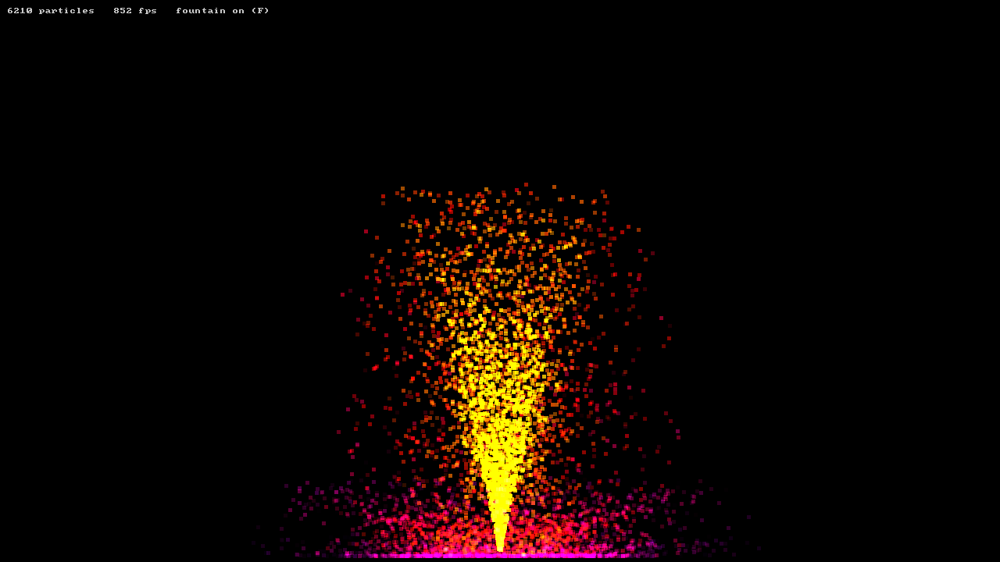

# Deeltjesfontein (C++, SDL3)

Een fontein van duizenden gloeiende deeltjes. Je spuit met de muis en laat het
met een klik ontploffen. Deeltjes vallen, stuiteren op de bodem en doven uit.



## Starten

```bash
pixi run start
```

| Bediening | Effect |
|---|---|
| Linkermuisknop ingedrukt | Spuiten vanaf de cursor |
| Rechtermuisknop | Explosie van 4000 deeltjes |
| `F` | Fontein aan/uit |
| `G` | Zwaartekracht aan/uit |
| `C` | Alles wissen |
| `Esc` | Stoppen |

| Taak | Wat het doet |
|---|---|
| `pixi run start` | Bouwen en starten |
| `pixi run test` | Tests van de simulatie (zonder venster) |
| `pixi run smoke` | 600 frames zonder scherm; het laatste frame komt in `build/shot.png` |
| `pixi run build-debug` / `test-debug` | Met AddressSanitizer en UBSan |

## Hoe het werkt

| Bestand | Inhoud |
|---|---|
| `src/particles.h/.cpp` | De simulatie: spawnen, bewegen, stuiteren, sterven. Geen SDL. |
| `src/main.cpp` | Venster, invoer, de game loop en het tekenen |
| `tests/particles_test.cpp` | Tests voor de simulatie |

**De game loop.** Elk frame doet drie dingen: invoer verwerken, de simulatie
vooruitzetten en tekenen. De simulatie loopt in **vaste stappen** van 1/120 s.
Een snelle pc doet per frame minder stappen dan een trage, maar de natuurkunde
is op beide gelijk.

**Integratie.** Elke stap rekent eerst de snelheid uit
(`v += g·dt`) en daarna de positie met die nieuwe snelheid (`x += v·dt`).
Dat heet *semi-impliciete Euler*. Draai je de volgorde om, dan komen
stuiterende deeltjes steeds hoger: er sluipt energie in.

**Structure of arrays.** Er is geen `std::vector<Particle>` maar één array per
eigenschap (`x_`, `y_`, `vx_`, ...). De update-lus leest die arrays van voor
naar achter, en dat is precies waar de CPU-cache goed in is.

**Verwijderen in O(1).** Een dood deeltje wordt overschreven met het laatste
deeltje, waarna de laatste plek vervalt. De volgorde maakt niet uit, dus dat
mag.

**Gloed.** Elk deeltje is een vierkantje van 4 hoekpunten, getekend met
`SDL_RenderGeometry` in één aanroep voor alle deeltjes samen. Met additief
mengen (`SDL_BLENDMODE_ADD`) tellen overlappende kleuren op tot wit.

## Leerdoelen

- De opbouw van een game loop en waarom een vaste tijdstap nodig is
- Numeriek integreren en het verschil tussen Euler en semi-impliciete Euler
- Het geheugenlayout (structure of arrays) en de cache
- RAII voor C-bibliotheken (`std::unique_ptr` met een deleter)
- Logica scheiden van I/O, zodat je hem kunt testen

## Opdrachten

1. **Opwarmen:** pas zwaartekracht, luchtweerstand en stuiterfactor aan in
   `Params`. Wat gebeurt er bij `bounce = 1.0`, en bij `1.1`?
2. **Wind:** voeg een horizontale kracht toe en regel die met de pijltjestoetsen.
3. **Plain Euler:** draai in `step()` de volgorde om (eerst positie, dan
   snelheid). Meet hoe hoog een stuiterend deeltje na 10 s komt. Schrijf er een
   test voor.
4. **Aantrekker:** laat deeltjes naar de cursor toe vallen terwijl je `Shift`
   ingedrukt houdt (kracht ∝ 1/r²).
5. **Meten:** hoeveel deeltjes haalt je pc bij 60 fps? Zet `kMaxParticles` op
   500 000 en zoek uit wat het meeste tijd kost: `step()` of het tekenen.
6. **Uitdaging:** vervang de `std::vector`'s door één array van structs
   (array of structures). Meet het verschil.
