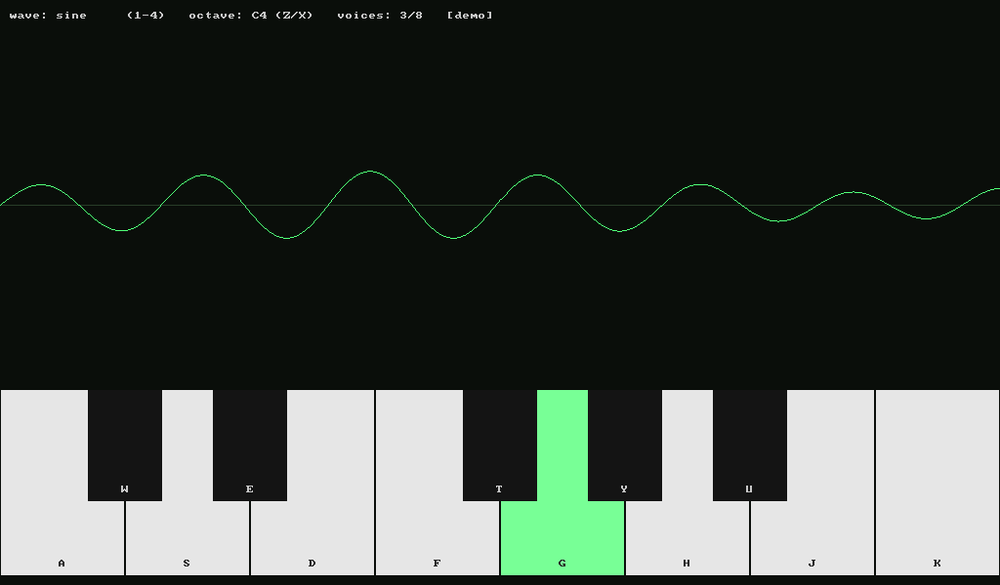

# Toetsenbord-synthesizer (C++, SDL3)

Je toetsenbord wordt een synthesizer: 8 stemmen, vier golfvormen, een
ADSR-envelope en de golfvorm live op een oscilloscoop.



## Starten

```bash
pixi run start
```

| Bediening | Effect |
|---|---|
| `A W S E D F T G Y H U J K` | Pianotoetsen, van C tot de C erboven (`W E T Y U` zijn de zwarte toetsen) |
| `1` `2` `3` `4` | Sinus, blok, zaagtand, driehoek |
| `Z` / `X` | Octaaf omlaag / omhoog |
| `Esc` | Stoppen |

De toetsen werken op fysieke positie (scancodes), dus ook op een AZERTY-toetsenbord.

| Taak | Wat het doet |
|---|---|
| `pixi run start` | Bouwen en starten |
| `pixi run test` | Tests van de synth (zonder geluidskaart) |
| `pixi run wav` | De demo opnemen in `build/demo.wav`, zonder venster of geluidskaart |
| `pixi run smoke` | De demo 3 s zonder scherm/geluid draaien; het laatste frame komt in `build/shot.png` |
| `pixi run build-debug` / `test-debug` | Met AddressSanitizer en UBSan |

`./build/cpp_synth --demo` speelt de demo hoorbaar af.

Werk je via SSH? Gebruik dan `pixi run wav` en haal het bestand op met
`scp pc:.../build/demo.wav .`.

## Hoe het werkt

| Bestand | Inhoud |
|---|---|
| `src/synth.h/.cpp` | Oscillatoren, envelope en stemmen. Geen SDL. |
| `src/wav.h/.cpp` | Een WAV-bestand schrijven, met de hand |
| `src/main.cpp` | Toetsenbord, audio-uitvoer, oscilloscoop en demo |
| `tests/synth_test.cpp` | Tests: toonhoogte, envelope, clipping, stemmen, WAV-header |

**Samples.** Geluid is een rij getallen tussen -1 en +1, hier 48 000 per
seconde (de *sample rate*). Elk getal is de stand van de luidsprekerconus.

**Oscillator.** Elke stem houdt een *fase* bij die van 0 naar 1 loopt en dan
opnieuw begint. Per sample schuift de fase `frequentie / sample_rate` op. De
golfvorm is een functie van die fase: `sin(2π·fase)`, `fase < 0.5 ? 1 : -1`, enzovoort.

**Envelope (ADSR).** Een toon die meteen op vol volume begint, klikt. De
envelope laat hem aanzwellen (*attack*), terugzakken (*decay*), aanhouden zolang
je de toets indrukt (*sustain*) en uitsterven als je loslaat (*release*).

**Twee threads.** SDL roept `audio_callback()` aan op een eigen audio-thread,
steeds als de geluidskaart nieuwe samples nodig heeft. De hoofdthread
verwerkt de toetsen en tekent. Ze delen de synth, dus ze sluiten elkaar uit
met de lock van de audio-stream. De callback mag nooit wachten: is hij te laat,
dan loopt de geluidskaart leeg en hoor je een tik.

**Oscilloscoop met trigger.** De scope begint te tekenen waar de golf omhoog
door nul gaat. Zonder die *trigger* begint elk frame op een willekeurig punt en
trilt het beeld.

**Soft clipping.** Acht stemmen tegelijk tellen op tot ver boven 1. `tanh()`
laat zachte signalen vrijwel ongemoeid en drukt harde signalen netjes onder de 1.

## Leerdoelen

- Digitaal geluid: sample rate, amplitude, frequentie en fase
- Golfvormen en hoe ze klinken, en aliasing
- Envelopes als kleine state machine (Off → Attack → Decay → Sustain → Release)
- Real-time programmeren: een audio-callback op een eigen thread, locking, deadlines
- Een binair bestandsformaat (WAV) met de hand schrijven

## Opdrachten

1. **Opwarmen:** verander de envelope in `Envelope`. Hoe maak je een
   orgelklank (geen decay, lange sustain)? En een tokkel (korte attack, geen sustain)?
2. **Vibrato:** laat de toonhoogte een paar keer per seconde licht op en neer
   gaan (een tweede, langzame oscillator, een *LFO*).
3. **Stereo:** open de stream met 2 kanalen en geef elke stem een eigen
   positie tussen links en rechts.
4. **Aliasing horen:** speel een hoge zaagtand (`X X X`, toets `K`). Hoor je de
   tonen die er niet horen? Zoek *PolyBLEP* op en implementeer het voor zaag en blok.
5. **Filter:** voeg een eenvoudig laagdoorlaatfilter toe
   (`y += a · (x − y)`) en regel `a` met de muis.
6. **Uitdaging:** laat het audiosignaal tegelijk naar de scope en naar een
   FFT gaan en teken het spectrum. Hoe verschillen de vier golfvormen in boventonen?
